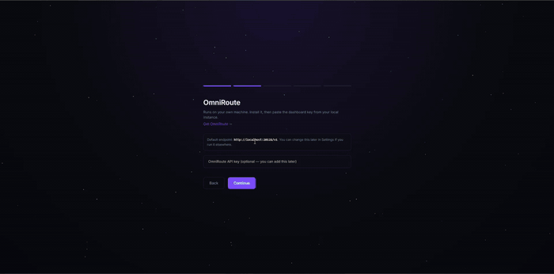

# Cosmos

**An AI-powered browser extension that reads pages, plans tasks, and acts — with memory.**

[](LICENSE)
[](https://developer.chrome.com/docs/extensions/mv3/)
[](https://www.typescriptlang.org/)
[](CONTRIBUTING.md)

<!-- Demo GIF — replace this comment with:  once you have a recording -->

---

## What is Cosmos?

Cosmos is an open-source Chrome extension that lets you describe a goal in plain English and watches it get done — automatically. It reads the live DOM, asks an LLM to build a step-by-step plan, executes browser actions (click, type, scroll, navigate), and learns from each run so it gets better over time.

No code. No configuration per site. Just describe what you want.

---

## Features

| Automation | Intelligence |
|---|---|
| ⚡ AI task planning and execution | 🧠 5-layer adaptive memory (session, user, site, workflow, failure) |
| 🎯 Click, type, scroll, navigate, select | 📋 Variable carry-forward between steps |
| 📸 Screenshot on step failure | 🔄 Workflow library with reuse and success tracking |
| 🖱️ Right-click context menu integration | 🕵️ Specialist agent for failure diagnosis |

| Control | UI |
|---|---|
| 🧪 Dry-run mode (plan without acting) | 📊 Live execution timeline with per-step status |
| 🔒 Blocked domains security list | 🌗 Dark / light / system theme |
| 🔔 System notifications on task complete | ⌨️ Keyboard shortcuts + quick-action chips |
| 📜 Task history with verdicts | 🔍 Memory insights panel |

---

## How it works

```
1. You type a goal        →  "Find the cheapest flight under £300"
2. Cosmos reads the page  →  Extracts DOM structure, forms, links, text
3. LLM plans steps        →  Validated JSON plan (zod schema)
4. Actions execute        →  Live timeline streams back to the side panel
```

Each run writes to memory — page notes, workflow patterns, failure recoveries — so Cosmos improves across sessions.

---

## Getting started

### Prerequisites

- Node 18+
- Chrome 114+ (Manifest V3 side panel support)
- An API key from [OpenRouter](https://openrouter.ai), [Groq](https://console.groq.com), or a local [OmniRoute](https://github.com/Cosmos-Agentic-AI/omniroute) instance

### Install

```bash
git clone https://github.com/Cosmos-Agentic-AI/Cosmos_browser_extension.git
cd Cosmos_browser_extension
npm install
npm run build        # outputs to dist/
```

Then in Chrome:

1. Go to `chrome://extensions`
2. Enable **Developer mode** (top right)
3. Click **Load unpacked** → select the `dist/` folder

On first install Chrome opens the onboarding page automatically — add your API key there to start using Cosmos.

### Supported AI providers

| Provider | Type | Default base URL |
|---|---|---|
| [OmniRoute](https://github.com/Cosmos-Agentic-AI/omniroute) | Self-hosted (local) | `http://localhost:20128/v1` |
| [OpenRouter](https://openrouter.ai) | Cloud | `https://openrouter.ai/api/v1` |
| [Groq](https://console.groq.com) | Cloud | `https://api.groq.com/openai/v1` |

You can override any base URL in Settings if you run a provider elsewhere (e.g. OmniRoute on a home server via Tailscale).

---

## Architecture

```
src/
  background/
    index.ts              Service worker entry — installs context menu, side panel behaviour
    router.ts             All request/response messaging (settings, memory) flows here
    orchestrator.ts       Task execution loop — plan → act → check → repeat
    chatPort.ts           Streams timeline/text/insights back to the UI over a named port

  content/
    domReader.ts          Extracts page structure into a PageSnapshot (interactive elements, forms, text)
    contentActions.ts     Executes click/type/scroll/select directly in the page context

  popup/                  Side panel UI (React 18 + Zustand)
    App.tsx               Root with bottom tab navigation
    components/           MessageList, ExecutionTimeline, ChatInput, MemoryInsights, ...

  modules/
    api-manager/          Settings persistence + unified LLM client (streaming + non-streaming)
    memory/               Dexie/IndexedDB schema + MemoryService — the only thing that touches the DB
    dom-reader/           Page snapshot extraction (background-side orchestration)
    browser-controller/   Tab control (background) + content-script action routing
    action-executor/      Routes a PlanStep to the right surface, normalises the result
    planner/              Goal + context → validated Plan (zod); variable carry-forward
    vision/               Screenshot + vision-model fallback (triggered when DOM read is thin)
    specialist-agent/     Stateless failure diagnosis → writes to FailureMemory + WorkflowMemory
    chat/                 Zustand store driving the UI off the streaming port

  shared/
    types/                Cross-cutting types: messages, settings, memory, dom, actions, chat
    utils/                sendToRouter, messaging helpers
    styles/               Tailwind globals, CSS custom properties, animations
```

**Key design rule:** background modules never import each other directly. All inter-module calls go through `router.ts` (request/response) or the `cosmos-chat` port (streaming). This keeps coupling low and makes each module independently testable.

---

## Development

```bash
npm run dev          # watch mode — rebuilds on save
npm run type-check   # TypeScript strict check (zero errors required)
npm run test         # Vitest unit tests
npm run build        # production build to dist/
```

After any change reload the extension at `chrome://extensions` → click the refresh icon on the Cosmos card.

---

## Contributing

Contributions are welcome — see [CONTRIBUTING.md](CONTRIBUTING.md) for the full guide.

The short version:

1. [Open an issue](https://github.com/Cosmos-Agentic-AI/Cosmos_browser_extension/issues) to discuss the change first (especially for new features)
2. Fork → create a branch → make your change
3. `npm run type-check` and `npm run test` must pass
4. Open a PR against `main` with a clear description of what and why

---

## Roadmap

See [ROADMAP.md](ROADMAP.md) for planned features and `good first issue` items for new contributors.

---

## License

[MIT](LICENSE) — Copyright © 2024 Cosmos-Agentic-AI contributors
